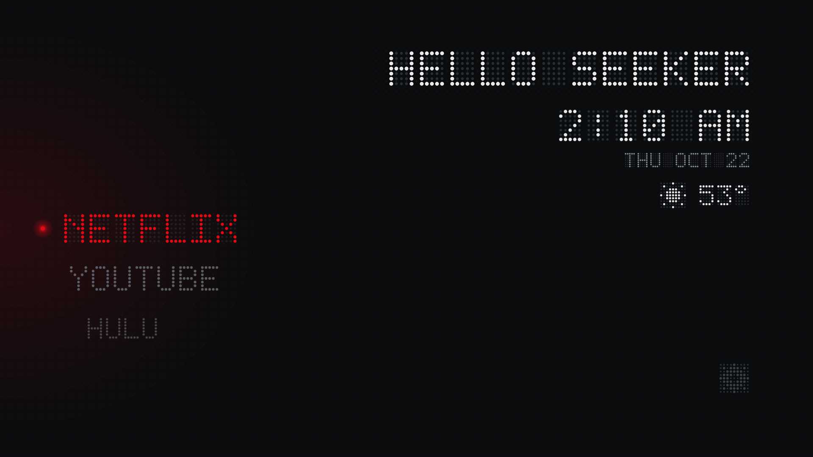
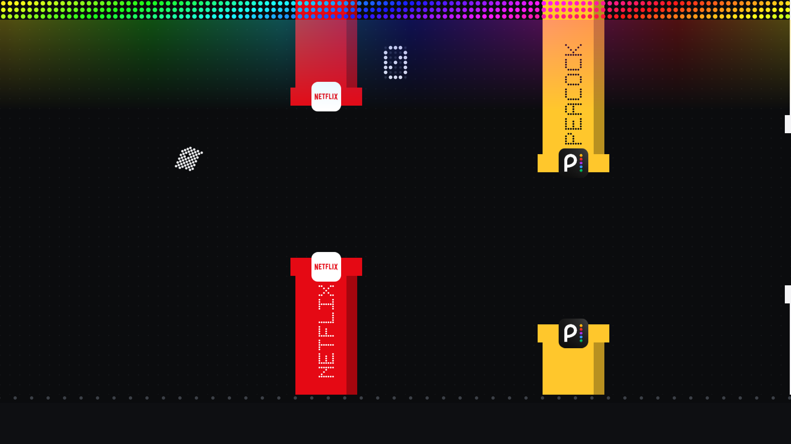
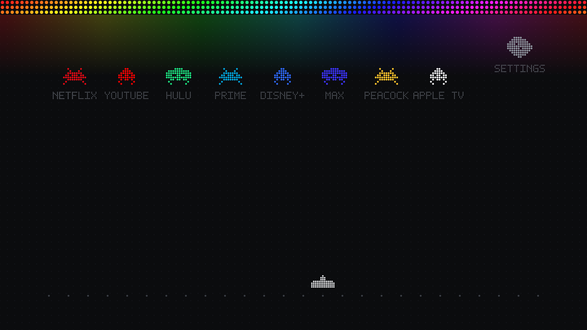
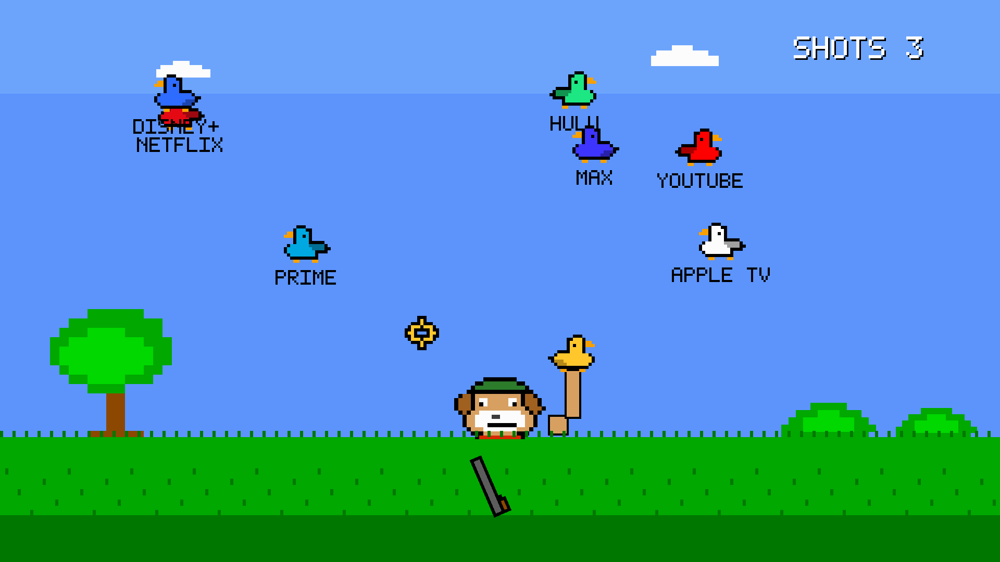

# Seeker TV

Seeker is a lightweight Android TV launcher with a dot matrix app wheel and optional arcade home modes. Settings include app title and color customization, infinite scroll on or off, a custom wallpaper with opacity control, and an adjustable left to right gradient for contrast.

## Build and export an APK

### Android Studio

1. Open the `launcher` folder in Android Studio and let Gradle sync.
2. In **Build > Select Build Variant**, choose `allDebug` for the full app.
3. Choose **Build > Build Bundle(s) / APK(s) > Build APK(s)**.
4. Android Studio shows a notification with **Locate** when the APK is ready.

The all modes APK is written to:

```text
launcher/app/build/outputs/apk/all/debug/seeker-all-0.9.0-debug.apk
```

The `debug` suffix means it is signed with the local debug key. It is suitable for installing on your own TV. Release builds need your own signing key.

### Command line

Install JDK 17 and Android SDK Platform 34. From a terminal in `launcher`, run:

```powershell
.\gradlew.bat assembleAllDebug
```

On macOS or Linux, run `./gradlew assembleAllDebug`. The APK appears at the path above. To build a smaller flavor, use `assembleWheelDebug`, `assembleFlapDebug`, `assembleInvadersDebug`, or `assembleHuntDebug` instead.

## Install the exported APK on your TV

### With ADB

1. Enable **Developer options** on the TV by opening **Settings > System > About** and pressing OK on **Android TV OS build** seven times.
2. In **Settings > System > Developer options**, enable **USB debugging** and, if offered, **Network debugging**.
3. Connect your computer and TV to the same network. Install [Android Platform Tools](https://developer.android.com/tools/releases/platform-tools), then connect to the TV:

   ```sh
   adb connect TV_IP_ADDRESS:5555
   ```

   Replace `TV_IP_ADDRESS` with the TV's address. Accept the debugging prompt on the TV.

4. Install the APK you exported. For example:

   ```sh
   adb install -r launcher/app/build/outputs/apk/all/debug/seeker-all-0.9.0-debug.apk
   ```

5. Open Seeker once:

   ```sh
   adb shell am start -n com.seeker.tv/.MainActivity
   ```

6. To use Seeker as the Home app, enable its Home entry and select it as the default:

   ```sh
   adb shell am broadcast -a com.seeker.tv.HOME_ALIAS --ez enabled true
   adb shell cmd package set-home-activity --user 0 com.seeker.tv/.Home
   ```

   You can also select Seeker under the TV's **Settings > Apps > Default apps > Home app** menu if your device provides that option. You do not need to disable the stock launcher.

### From USB storage

Copy the exported APK to a USB drive, open it with a file manager on the TV, and follow Android's install prompts. If Android blocks the install, allow that file manager to **Install unknown apps**, then open the APK again. To make Seeker the Home app, open Seeker once and follow step 6 above, or choose it in the TV's Home app settings.

## Optional permissions

Seeker works without these. They enable animation speed control and notification overlays, respectively:

```sh
adb shell pm grant com.seeker.tv android.permission.WRITE_SECURE_SETTINGS
adb shell appops set com.seeker.tv SYSTEM_ALERT_WINDOW allow
```

## Available APK flavors

Every flavor includes the regular app wheel. The `all` flavor includes all game modes.

| Build task | Modes included |
| --- | --- |
| `assembleWheelDebug` | Wheel |
| `assembleFlapDebug` | Wheel, Flap |
| `assembleInvadersDebug` | Wheel, Invaders |
| `assembleHuntDebug` | Wheel, Hunt |
| `assembleAllDebug` | Wheel, Flap, Invaders, Hunt |

## Project layout

- `launcher/app/src/main` — shared launcher, settings, weather, and notification code
- `launcher/app/src/modeFlap`, `modeInvaders`, `modeHunt` — optional game modes
- `launcher/app/src/<flavor>` — mode list for each APK flavor
- `design` — current design references and specifications
- `restore-kit` — recovery scripts for restoring the TV's Home app

## Screenshots

| Wheel | Flap | Invaders | Hunt |
| --- | --- | --- | --- |
|  |  |  |  |

## License

MIT. See [LICENSE](LICENSE).
